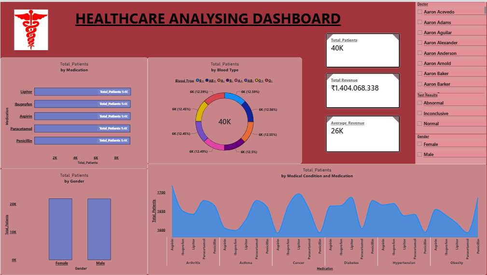

# Healthcare Power BI Dashboard

## Project Overview
This project presents a healthcare data analysis dashboard created using Microsoft Power BI. It aims to make healthcare data easier to understand through data visualization and reporting.

## Tools Used
- Microsoft Power BI
- Power Query
- DAX

## Project Objectives
- Analyze healthcare data.
- Present data using visualizations.
- Identify useful patterns and trends.
- Support data-driven decision-making.

## Dashboard Preview

